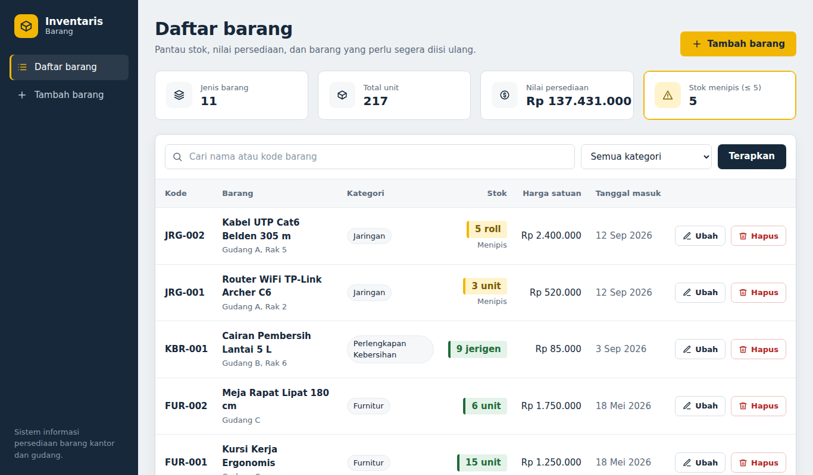

# Sistem Informasi Inventaris Barang

Aplikasi web CRUD untuk mencatat dan mengelola persediaan barang kantor/gudang, dibangun dengan **PHP native** dan **MariaDB**. Proyek ini dibuat sebagai bukti unjuk kerja (portofolio) untuk Uji Kompetensi BNSP bidang pemrograman web.

> Demo online: `http://nama-anda.infinityfreeapp.com` *(ganti dengan link Anda)*



## Fitur

- **Create** — menambah barang baru lengkap dengan kategori, stok, satuan, harga, lokasi, dan tanggal masuk.
- **Read** — daftar barang dengan pencarian (nama/kode), filter kategori, dan paginasi 10 data per halaman.
- **Update** — mengubah data barang yang sudah tersimpan.
- **Delete** — menghapus barang dengan konfirmasi.
- Ringkasan persediaan: jumlah jenis barang, total unit, nilai persediaan (Rp), dan jumlah stok menipis.
- Penanda status stok: aman, menipis (≤ 5), dan habis.
- Dialog konfirmasi sebelum menghapus data.
- Tampilan responsif untuk desktop dan ponsel, serta mendukung mode gelap otomatis.

## Keamanan yang diterapkan

| Ancaman | Penanganan |
|---|---|
| SQL Injection | Semua query memakai **PDO prepared statement** dengan parameter terikat |
| XSS | Semua output di-*escape* dengan `htmlspecialchars()` melalui fungsi `e()` |
| CSRF | Token acak per sesi diverifikasi pada setiap form POST (`hash_equals`) |
| Hapus via tautan | Penghapusan hanya menerima metode **POST**, bukan GET |
| Data tidak valid | Validasi di sisi server (wajib isi, format kode, angka ≥ 0, tanggal valid, kode unik) |
| Integritas data | *Foreign key* `barang → kategori` dan *unique key* pada kode barang |

## Teknologi

- PHP 7.4+ (diuji pada PHP 8.3)
- MariaDB 10.x / MySQL 5.7+
- HTML5, CSS3, dan JavaScript murni (tanpa framework)
- XAMPP untuk pengembangan lokal

## Struktur folder

```
inventaris-barang/
├── index.php              # READ  : daftar, cari, filter, paginasi
├── tambah.php             # CREATE: form tambah barang
├── edit.php               # UPDATE: form ubah barang
├── hapus.php              # DELETE: proses hapus (POST + CSRF)
├── config/
│   └── database.php       # konfigurasi & koneksi PDO
├── includes/
│   ├── functions.php      # fungsi bantu: escape, CSRF, flash, validasi
│   ├── header.php         # template bagian atas
│   ├── footer.php         # template bagian bawah
│   └── form-barang.php    # form yang dipakai bersama tambah & edit
├── assets/
│   ├── css/style.css      # tampilan (layout, warna, responsif, mode gelap)
│   └── js/app.js          # dialog konfirmasi hapus & tutup notifikasi
└── database/
    └── db_inventaris.sql  # struktur tabel + data contoh
```

## Struktur database

**kategori** — `id_kategori` (PK), `nama_kategori` (unik)

**barang** — `id_barang` (PK), `kode_barang` (unik), `nama_barang`, `id_kategori` (FK), `jumlah`, `satuan`, `harga`, `lokasi`, `tanggal_masuk`, `created_at`, `updated_at`

Relasi: satu kategori memiliki banyak barang (one-to-many).

## Cara menjalankan di komputer (XAMPP)

1. Salin folder `inventaris-barang` ke `C:\xampp\htdocs\`.
2. Jalankan **Apache** dan **MySQL** dari XAMPP Control Panel.
3. Buka `http://localhost/phpmyadmin`, buat database baru bernama `db_inventaris` (collation `utf8mb4_unicode_ci`).
4. Pilih database tersebut → tab **Import** → pilih `database/db_inventaris.sql` → **Import**.
5. Buka `http://localhost/inventaris-barang/` di browser.

Jika user/password MySQL Anda berbeda dari bawaan XAMPP (`root` tanpa password), ubah di `config/database.php`.

## Cara deploy ke InfinityFree

1. Di panel InfinityFree, buat database lewat **MySQL Databases**. Catat *host*, *nama database*, *username*, dan *password*.
2. Buka **phpMyAdmin** dari panel, pilih database tadi, lalu **Import** file `database/db_inventaris.sql`.
3. Edit `config/database.php`, isi keempat nilai sesuai data dari langkah 1.
4. Buka **File Manager**, masuk ke folder `htdocs`, lalu unggah seluruh isi proyek (termasuk folder `config`, `includes`, `assets`).
5. Akses domain gratis Anda, misalnya `http://nama-anda.infinityfreeapp.com`.

## Pembuat

**Nama Anda** — [github.com/username-anda](https://github.com/username-anda)
